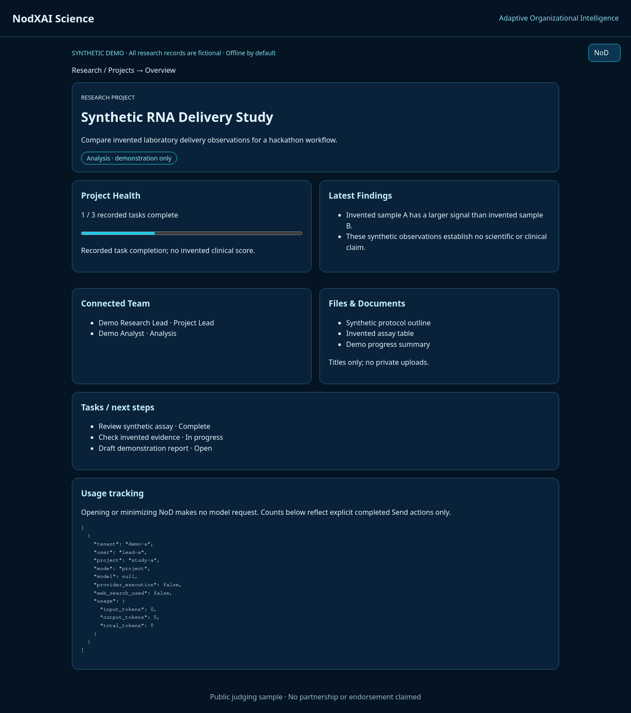
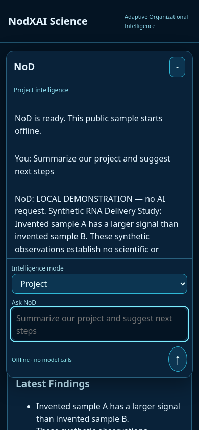

# Judging workflow

1. Run the local server and open the browser address in README.
2. Observe the SYNTHETIC DEMO label and fictional project identity.
3. Review the recorded task completion, findings, team roles and document titles.
4. Open NoD. Ask “Summarize our project and suggest next steps.” Offline mode clearly returns a local record summary, not an AI answer.
5. Type a draft, minimize, then reopen. The draft and conversation remain in browser memory; no provider usage is created.
6. Switch to General intelligence and ask a general question. Project context is excluded from the request. Offline mode explains its limits.
7. Mixed intelligence requests external research only in explicitly enabled live mode. A live answer requires completed web search and supplies actual provider citations when returned.
8. Inspect Usage: offline interactions show zero model calls; live records reflect returned usage or explicitly unknown counts. There is no billing integration.
9. Run the tests to verify other-tenant and unassigned-user denial and general-context exclusion.

Screenshots:
- 
- 

The fixture is not a medical study, clinical dataset, actual employee roster or patient record. No real demo account is required. A refresh resets conversation and usage state. Do not present offline output as Meta-generated.
